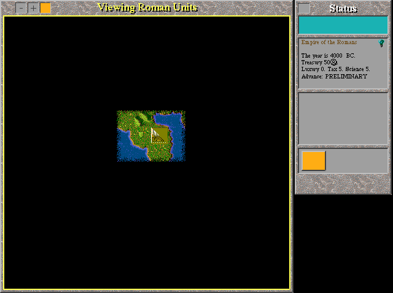
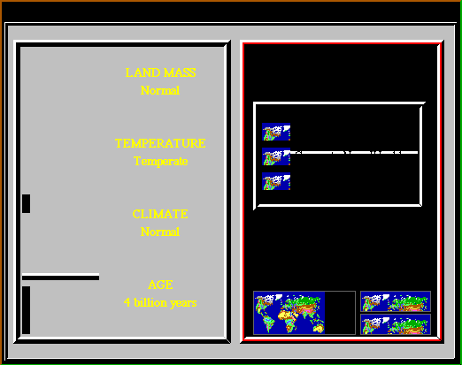
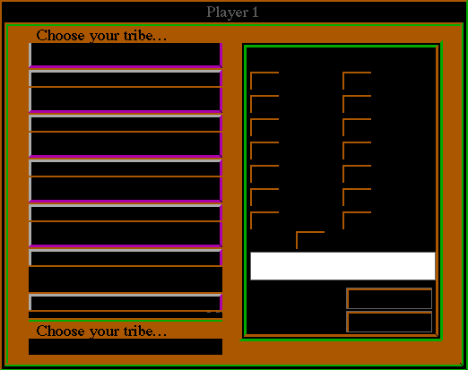
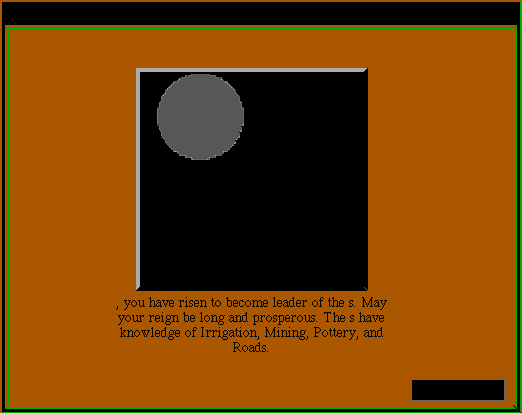
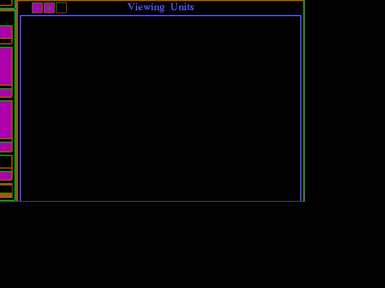

# Sid Meier's CivNet — Static Recompilation

Static recompilation of **Sid Meier's CivNet** (MicroProse, 1995), the
Windows 3.1 networked Civilization, from its shipping 16-bit (NE) executable
to native C that runs as a Windows program: no emulator and no Windows 3.1.
`CIVNET.EXE`, `SMEDSNET.DLL` (its network layer) and `TIMERDLL.DLL` are lifted
together by pcrecomp's NE front end and run on its Win16 host, which answers
KERNEL, USER, GDI, WinG and MMSYSTEM with Win32. The game's own code draws
every screen; nothing is reimplemented.

Built on the [pcrecomp](https://github.com/sp00nznet/pcrecomp) toolchain
(`main`), in the same
house style as the [Space Bucks](https://github.com/sp00nznet/spacebucks-recomp)
and [Catz](https://github.com/sp00nznet/catz-recomp) recomps.

## Getting Started

You need **your own copy of CivNet**: the CD, a copy of its files, or an
`.iso` of it. Nothing from the game is in this repository or downloaded for
you; everything is built on your machine from your copy. There is no
installer release yet.

### The setup scripts

1. Download this repository (the green **Code** button, then **Download ZIP**)
   and unzip it somewhere with 600 MB free.
2. Windows: double-click **`Setup.cmd`**. Linux and macOS aren't supported yet
   (`setup.sh` says so).
3. Play with **`CivNet.cmd`** in that folder.

The script asks before installing anything (Python 3.10+ with `capstone`,
CMake, Ninja, MSYS2's MinGW-w64 gcc), clones pcrecomp beside this folder
if it is missing, finds the CD or asks where the
game is (`-GameDir E:\` or `-GameDir civnet.iso`; `-Yes` answers yes to
everything), copies it into `game\`, lifts it and builds `build\civnet.exe`.
The lift downloads Wine's Win16 ordinal tables once (a few hundred KB) to
name the imports. A rerun skips finished steps; if it stops, it says why in
one sentence, and the details are in `setup.log`. Building by hand is in
**[docs/building.md](docs/building.md)**.

## Status

**v0.1.0-dev, early alpha: in game, the map draws and the settlers move.**
The lift is 38,147 functions with 2 unresolved, from pcrecomp's own code map
(no IDA).

| | State |
|---|---|
| Intro movies (MicroProse, credits) | run, full frame |
| Main menu, new game, world setup, tribe, leader, introduction | run, with Enter for every default |
| The game screen | runs: terrain, coast, the settlers, the World map and the chrome draw; arrow keys move the settlers; autosave writes `AUTO_1.SAV` |
| Labels in the game's own list and edit controls | blank (tribe and leader names are empty) |
| Founding a city, later turns | not yet tried |
| Sound, music, multiplayer | not yet |
| Headless mode, conformance harness | not yet; runs are checked by hand ([docs/testing.md](docs/testing.md)) |

[docs/bringup.md](docs/bringup.md) is the log of each wall and its fix, and
[ROADMAP.md](ROADMAP.md) what comes next.

## Screenshots

Real output of `build\civnet.exe`, recompiled code throughout, captured with
`CIVNET_SHOT`:

| | |
|---|---|
|  |  |
|  |  |

## Documentation

- [docs/building.md](docs/building.md): building by hand, the trip-ups
- [docs/testing.md](docs/testing.md): scripted input and captures (`CIVNET_KEYS`, `CIVNET_SHOT`)
- [docs/bringup.md](docs/bringup.md): every wall so far and its fix
- [ROADMAP.md](ROADMAP.md), [CHANGELOG.md](CHANGELOG.md), [CONTRIBUTING.md](CONTRIBUTING.md)

## Contributors

See **[CONTRIBUTORS.md](CONTRIBUTORS.md)** for who did what.

## License

MIT for this repository's own code ([LICENSE](LICENSE)). CivNet is © 1995
MicroProse; none of its files, and nothing generated from them, is in this
repository ([NOTICE.md](NOTICE.md)).
